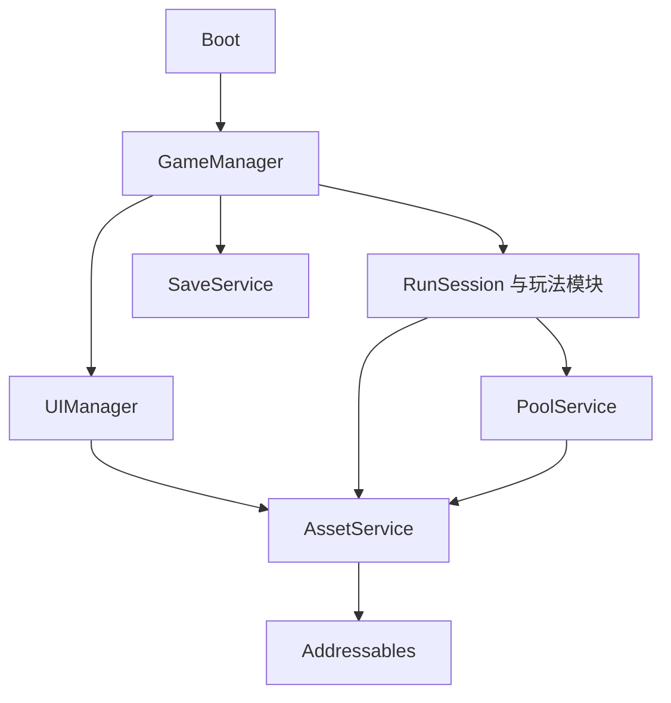

# 工程架构与开发约束

> 当前52验收状态：新增内容已实装；210编辑器、244完整玩法、222 UI、8地形检查通过，正式配置首胜/重启与新档六Boss/25任务通过，独立核心美术91分/20项/原10门槛通过。固定520级180.2秒预检完成。首轮成长长测仅1440秒/48窗口、最低40.44FPS、4窗低60，已中止且原退出-1，不是7200秒或性能通过。用户明确正在使用MuMu，要求保留模拟器并暂缓独占性能验收；已停止自己的测试Player，保留MuMu和原Unity。未来需获准恢复后全新连续7200秒及独立末帧复核；无1.2.0最终ZIP。详见[52记录](Expansion52Review.md)与[长测限制](Soak52Review.md)。

> 当前1.2.0候选51已实装两群系/四怪种与精英/两Boss/三武器，合计六群系与Mixed、八敌种、六Boss、九武器、60升级、25任务。开发/正式构建和207编辑器、243完整玩法、215 UI、8地形检查已完成；1309源文件/24AA精确一致。正式配置自然祭坛/林地首胜结算与同档重启荒漠已完成。新档自然流程实际2177.1秒、8局含1次死亡，六Boss/25任务完成、0错误/原退出0。独立同版核心美术91分、20项及10门槛通过；固定深构筑末帧已独立补看；持续成长长测末帧与本版性能验收尚未完成，禁止沿用42/47旧评分或长测。详见[扩充51记录](Expansion51Review.md)。

日期：2026-10-22。状态：冻结42的工程基线、Windows正式配置与同版验收已完成；归档前快照及实际证据见ImplementationStatus.md、ReleaseAcceptance.md，最终ZIP由Delivery42/侧车审计确认。

玩法依据 [GameDesign.md](GameDesign.md)，交付顺序与验收依据 [DevelopmentWorkflow.md](DevelopmentWorkflow.md)。用户后续明确调整优先于本文。

## 1. 已确认的硬约束

1. AA 指 Unity Addressables，运行时内容统一经 AA 异步加载。
2. UI、角色、敌人、Boss、武器、投射物、掉落、特效、场景道具与地图块等所有项目制作的 `.prefab` 统一放在 `Assets/Art/Prefabs/` 下。
3. 整体流程由唯一的 `GameManager` 控制，包括启动、菜单、开局、局内、结算与返回。
4. UI 生命周期与层级统一由唯一的 `UIManager` 控制。
5. 不增加武器或被动槽位上限，不将同一武器的小路线改成互斥。
6. Boss 主动挑战、允许脱战，地图与任务解锁沿用已确认设计。

Boss挑战由CombatWorld统一保留召唤请求：2秒游戏时钟后从既有池生成，重复请求不重置倒计时；暂停冻结，离场沿用25米/2秒缓冲并可在召唤期取消。延迟生成读取当前BossCenter，兼容浮动原点；WorldService在召唤期同样保护挑战地点驻留。EnemyActor的1秒出场状态隔离移动、接触伤害、技能与受击，结束后恢复正常；CanBeTargeted供查询/自动索敌过滤。返回菜单Dispose清理请求，仍由GameManager控制流程与池/AA资源释放。

## 2. 当前项目与技术工作基线

成长目录在运行时视为不可变数据：Upgrade按Ordinal ID建立非序列化惰性索引，目录数组被替换或Unity重新启用/验证资产时失效。局内升级等级仍逐次从RunState读取，不缓存成长效果数值，保留并行路线、叠加与购买即时生效。目录索引不持有额外AA租约，不延长目录资产的所有权。

当前实现：Unity `2022.3.62f2`；内置渲染管线；旧输入系统；UGUI 中文界面；Addressables `1.22.3` 已安装并锁定。Boot 为唯一内置启动场景，菜单、游戏场景与运行时内容由 AssetService 经本地 AA 加载。原始 MainMenu 场景备份保留在 Docs/ProjectBaseline。

以下采用工作默认，不代表此前讨论已经逐项确认：

- 首发实现先面向 Windows x64、键鼠、单人离线。
- 保持当前 Unity 版本、内置渲染管线、UGUI/TMP 与旧输入系统；通过 `InputService` 隔离具体输入 API，默认采用 WASD 移动、Shift 闪避、E 交互、右键标记、滚轮缩放。
- 在基础阶段安装适配当前编辑器的稳定 Addressables 版本，记录并锁定 `manifest.json` 与 `packages-lock.json`；本文不虚构尚未验证的包版本。
- 默认使用 Unity 原生协程/异步操作与 C# 能力，不因架构设计额外引入异步、依赖注入、响应式或热更框架。
- 初版使用本地 AA 内容构建，支持离线运行；远程目录和热更新不是本次成品的默认要求。
- 性能参考目标为基准 PC 上 1080p、60 FPS；具体硬件、压力规模和预算在 M0 记录，尚非已验证性能。

自定义UGUI Graphic必须显式声明CanvasRenderer依赖，并在作者预制体中实际序列化该组件（包括未激活模板）。构建Validate通过GetComponent检查，不能用会懒创建组件的Graphic.canvasRenderer属性掩盖缺失。AbilityIcon、MapGraphic遵循此约束；UI回归覆盖列表重建、RectMask2D裁剪、禁用与延迟销毁。

## 3. 目录约定

```text
Assets/
  Art/
    Prefabs/
      UI/                   # UIRoot、页面、弹窗、提示、界面组件
      Characters/           # 玩家角色
      Enemies/              # 普通怪与精英
      Bosses/
      Weapons/
      Projectiles/
      Pickups/
      VFX/
      World/                # 地图块、地标、交互物、装饰
      Systems/              # 如需可复用的系统预制体，同样放这里
    Models/                 # FBX 等导入模型，不作为运行时实例入口
    Materials/
    Textures/
    Animations/
    UI/                     # 图集、字体等 UI 原始资源，不放 .prefab
    Audio/
  Config/
    Catalogs/               # ID 与 AssetReference 映射
    Characters/
    Abilities/
    Upgrades/
    Enemies/
    Biomes/
    Tasks/
    Balance/
  Scenes/
    Boot.unity
    MainMenu.unity
    Gameplay.unity
    Tests/
  Scripts/
    Runtime/
      Core/                 # GameManager、状态、上下文与流程请求
      Infrastructure/       # AssetService、InputService、SaveService、PoolService、音频
      UI/                   # UIManager、页面绑定与显示逻辑
      Gameplay/
        Actors/
        Combat/
        Abilities/
        Progression/
        World/
        Encounters/
      Data/                 # 配置类型、运行时状态、存档 DTO
    Editor/                 # 构建、资源登记与检查工具
    Tests/
      EditMode/
      PlayMode/
  AddressableAssetsData/     # 由 AA 工具生成的设置、分组
Docs/
```

- `.cs` 不放入 Art；`.prefab` 不放入 Scripts、Scenes 或 Config。
- 引用导入模型时，制作 `Art/Prefabs` 下的包装预制体，附加碰撞、动画绑定和运行时组件。
- 保留 Unity `.meta` 和 GUID，移动资源同步移动 `.meta`，不以重新创建代替移动。
- 测试预制体也位于 `Art/Prefabs`，用测试子目录或标签识别，并从正式内容构建中排除。
- 测试、Editor 与 Runtime 按职责隔离；运行时代码不依赖 Editor API。

## 4. 模块职责与依赖

| 模块 | 负责 | 边界 |
| --- | --- | --- |
| GameManager | 全局流程状态、开局/结算、初始化和释放顺序、场景切换编排 | 调用各模块，不承载全部战斗、地图生成和 UI 实现 |
| UIManager | UIRoot、页面/弹窗、层级、输入阻挡、异步打开关闭、界面资源所有权 | 不判定伤害、发奖励、改任务解锁或直接写存档 |
| AssetService | 唯一 AA API 适配入口，资源加载、实例化、场景操作、句柄所有权与诊断 | 不决定游戏流程或内容解锁 |
| PoolService | 高频对象池、预热、借出归还、状态重置、清空 | 通过 AssetService 持有 AA 资源，不提前释放仍在使用的预制体 |
| SaveService | 持久化、版本迁移、备份、恢复 | 不由 UI 直接发放或重算奖励 |
| InputService | 输入读取、映射、游戏/UI 输入上下文 | UI 接管输入时不向角色发送移动、闪避和标记命令 |
| RunSession | 本局种子、时间、角色状态、能力、资源与一次性结算标识 | 每次开局重新创建，结束后清理 |
| Combat/Ability 模块 | 索敌、伤害、状态效果、武器调度、标签与强化组合 | 不直接打开 UI 或切换全局场景 |
| World/Encounter 模块 | 地图生成与流式加载、地标、精英、Boss 激活/脱战 | 不绕过 GameManager 发起结算 |
| Progression/Task 模块 | 经验、升级候选、购买校验、任务、永久解锁与奖励账本 | UI 只展示结果和提交请求 |



图中为主要调用关系。玩法模块通过明确事件或只读状态通知 UI，玩家意图通过命令/请求交给流程或玩法模块，不通过 UI 组件互相查找。

### GameManager 规则

- 唯一跨场景实例，重复实例必须检测并清理；按明确顺序初始化依赖。
- 全局状态建议为 `Boot → MainMenu → PreparingRun → InRun → Settling → MainMenu`，并提供可恢复的加载失败路径。
- Boss 战属于本局 Encounter 状态，胜利不直接触发本局结束。
- 死亡、撤离和重复点击只能触发一次结算；使用本局唯一 ID 与结算账本去重。
- 状态切换过程中锁定冲突请求。新场景准备成功后再进入新状态；失败时清理已创建资源并回到可用页面。
- 暂停集中管理，采用原因集合或令牌处理技能树、升级选择和暂停菜单的嵌套；UI 不直接修改 `Time.timeScale`。
- 返回菜单时统一恢复时间尺度与输入上下文，清理本局任务、事件订阅、对象池、世界块和 AA 所有权。

### UIManager 规则

- 所有运行时游戏页面、弹窗和 UI 组件预制体均从 `Art/Prefabs/UI` 经 AA 获取。
- 页面控制器只处理显示、绑定和用户意图，属性购买、解锁与奖励由业务模块校验。
- UIRoot只包含Bottom、Common、Pop、Top四个全屏RectTransform容器，按该顺序绘制，不序列化全部面板。HUD默认Bottom，主页面Common，模态弹窗Pop，加载/提示/受击反馈Top；具体层级由每个UIPanel基类的layer字段决定。
- 同一页面并发打开要合并请求或明确允许多实例；关闭先于加载完成时，迟到实例必须回收。
- 关闭时解绑事件。缓存页面的资源仍由 UIManager 持有，清缓存时才销毁并释放。
- UI 中的右键、滚轮和点击不透传给世界。地图缩放和镜头缩放按当前输入上下文区分。
- 中文字体、分辨率适配、长文本和手动标记反馈纳入验收。

## 5. 启动与场景加载

1. `Boot.unity` 是 Player Build Settings 的唯一启动场景，包含最小 GameManager 引导与必需的基础对象。
2. Boot 可内置极简静态加载/错误文字，供 AA 初始化失败时反馈；它是场景对象，不是旁路加载的游戏 UI 预制体。
3. 初始化 AA、日志、配置、存档，再初始化 UIManager 并经 AA 加载 UIRoot。
4. MainMenu 与 Gameplay 通过 AssetService 使用 AA 场景加载/卸载，保留 Boot，采用显式管理的附加场景生命周期。
5. UIRoot 等跨场景资源独立加载并持有，不依靠把 AA 场景中的对象移动到常驻层来保住其资源。
6. 业务场景只提供相机、灯光、场景根等静态骨架，动态角色、游戏 UI、地标和武器通过 AA 生成。
7. 场景切换具有加载遮罩、进度反馈与错误恢复；编辑器测试入口也必须经过相同初始化流程。

AA 的场景加载与资产生命周期规则参见 Unity 官方 [场景加载文档](https://docs.unity3d.com/Packages/com.unity.addressables@1.21/manual/LoadingScenes.html) 与 [卸载说明](https://docs.unity3d.com/Packages/com.unity.addressables@1.21/manual/UnloadingAddressableAssets.html)。

## 6. AA 资源加载与释放约束

### 入口、引用与打包

- 项目游戏运行时代码只通过 AssetService 接触 AA；直接 AA API 调用限于该适配层，Editor 构建与检查工具除外。
- 不用 `Resources.Load`、`AssetDatabase`、手动 AssetBundle 加载或同步等待作为运行时资源加载后门。
- 允许预制体内部直接引用自身组件、网格、材质、动画和必要依赖；禁止用场景对动态游戏预制体的硬引用绕过 AA。
- 使用稳定内容 ID 与集中目录映射到 AssetReference，禁止业务代码散落地址字符串。
- 示例地址：`ui/main-menu`、`character/adventurer`、`weapon/fireball`、`boss/forest-guardian`、`scene/gameplay`。
- 分组初步按 Core、UI、Characters、CombatShared、各群系内容划分；按生命周期、依赖与实测包体调整，避免重复依赖和一个请求拉入全部群系。
- 常用资源按需预热；混合地图只加载附近活跃群系资源，不一次加载所有群系。
- 每个正式资源进入构建前登记 ID、来源、分组、生命周期和依赖。

### 两种实例所有权

| 使用场景 | 创建 | 所有者 | 回收 |
| --- | --- | --- | --- |
| 少量 UI 或一次性对象 | AssetService 封装 `InstantiateAsync` | 请求方的实例租约 | 对应 `ReleaseInstance`，不可再重复释放同一次实例所有权 |
| 子弹、怪物、特效等高频对象池 | AA 加载预制体一次，池内普通 Instantiate | 池持有预制体句柄 | 归还时停用重置；池关闭时销毁全部克隆，再 Release 预制体句柄 |
| 音频、图标、配置等资产 | AssetService 封装 `LoadAssetAsync` | 明确的模块/作用域 | 不再使用时 Release 对应句柄 |
| 业务场景 | AssetService 封装 `LoadSceneAsync` | GameManager 编排的场景作用域 | 对应场景卸载；操作句柄按 API 的自动释放设置统一处理 |

以上是项目采用的所有权约定。AA 以引用计数管理资源，显式加载需要对应释放；引用归零也不等于内存立即回收。依据 Unity 官方 [内存管理说明](https://docs.unity3d.com/Packages/com.unity.addressables@1.21/manual/MemoryManagement.html)。

### 异步与故障处理

- 每个加载请求可追踪资源 ID、所有者、状态和句柄；重复加载允许共享底层请求，但租约数必须正确。
- 请求取消或拥有者销毁不等于 AA 底层加载一定终止；完成后必须丢弃并释放已失效请求的结果。
- 失败操作也按 API 所有权规则收尾；不吞异常、不无限自动重试、不保留失败句柄。
- 不在战斗热路径使用阻塞等待或主动全局卸载；AA 释放检查与内存实测分开记录。
- 对象池归还必须重置伤害、生命、标签、目标、计时、粒子、拖尾、事件和异步回调代次。
- 手枪/火球/飞剑由各自WeaponAttack实现出手节奏与表现，AbilityController拥有调度、共用数值和生命周期。待发攻击绑定敌人CollisionId，原目标死亡/复用时重新索敌；暂停冻结游戏时钟，Dispose清理队列。ProjectileActor的不同运动状态共享命中、元素和池归还，浮动原点须同步弧线起终点；返航飞剑不重复伤害。持续火焰区域归CombatWorld拥有并随场景释放。沿用已有AA预制体及池租约，不从行为脚本创建旁路资源。
- 灵体/爆破炮/符阵亦由独立WeaponAttack调度。额外灵体模型归SpiritAttack，炮弹独占静态落点圈，RuneAttack显式管理临时阵纹；全局流程仍归GameManager。静态mark没有TransientEffect组件；托管阵纹的计时和回收由攻击对象负责，重新租作普通特效时必须清除托管状态。PoolService.Clear先清登记再销毁快照，允许OnDisable安全尝试归还附属对象；浮动原点同时移动召唤蓄势缓存、炮弹起终点与静态圈、符阵中心。
- 九种武器均使用各自WeaponAttack，AbilityController不再保留通用Shoot后备路径。弩的拉弦队列遵循同一目标生命校验；回旋刃使用CurvedReturn状态，缓存起点/途经点/终点与侧向曲率，返回时按当前玩家位置偏移路径，每段独立去重。旧InitializeReturn保留兼容诊断接口，实际武器使用InitializeCurvedReturn。寒气由FrostStaffAttack持有定时阶段，按当前玩家位置和施法时锁定方向查询扇形，检查遮挡；短时冰冷积累归EnemyActor当前生命，过期、重新Initialize均清空。普通frost命中仍沿用概率冻结，chill只用于寒气的确定积累，烧伤tick不重复叠加chill。临时冰霜特效仍归现有池并自动到期。
- 飞剑追击的三次贝塞尔求值由ProjectileSword管理，目标终点逐帧更新，起点和控制点保持世界坐标；贯穿/弹射/目标生命失效重新构建曲线，归池重置全部参数。环绕模型以本地+Y为剑尖轴，对齐圆周运动切线；投射物模型已在预制体内转为+Z，按轨迹切线朝向。SwordAttack拥有固定剑雨区域及托管圆圈，Tick发放波次，Dispose清理未发波次与圈；CombatWorld只移动其TransientEffect圈一次，SwordAttack.ShiftOrigin只移动区域缓存中心。
- 持续剑域调用TransientEffect.PresentManaged时关闭瞬时几何动画，固定圈的实际边界，仅保留展开、发光与可见度淡出；其他托管特效默认保留原动画。Initialize必须恢复_FxStyle，避免剑域圈归池后影响符阵/普通特效的再次使用。
- 返回菜单后，除明确声明的常驻资源与受控缓存外，不保留本局资源租约。

## 7. 配置、存档与数据约束

- ScriptableObject 配置放 `Assets/Config`，经 AA 目录加载；配置是只读模板，局内状态放独立运行时对象。
- 武器、强化、任务、角色、群系使用稳定唯一 ID，存档不保存 Unity 对象引用、临时 instance ID 或可变中文显示名。
- 强化显式区分数值累加、乘算、额外攻击形态和一次性机制；标签适用范围写入配置与 UI。
- 随机候选与定向购买使用相同的能力定义、前置依赖、任务解锁和应用入口。
- 任务奖励与 Boss 首胜立即记录，任务完成、领取、结算和异常重试必须幂等。
- 存档默认覆盖永久进度、属性、任务、解锁、设置和纪录；局内中断续玩是否列入 1.0，需在 M0 明确，不能对外宣称已有该能力。
- 存档有 schema 版本、临时文件替换、备份与迁移策略；损坏时提供恢复路径，不静默覆盖有效备份。
- 无依赖的基础内容保证解锁图可达，编辑器检查不可达、循环依赖和不存在的奖励 ID。

## 8. 无限地图与性能约束

- 地形由世界种子、稳定区块坐标和生成版本确定；返回旧区域不得改变地形。
- 地标和事件使用稳定 ID；已领取奖励、已击败 Boss 等改变持久记录，卸载区块不能恢复已领取内容。
- 区分世界逻辑坐标与 Unity 局部浮点坐标，长距离探索引入浮动原点并覆盖角色、相机、粒子、投射物和物理对象。
- 只驻留玩家附近区块，设置加载、预取和卸载半径及每帧工作预算；运行内存不随走过的总地图面积无界增加。
- 历史变更数据可随探索量增长，但分块落盘/缓存，不能把全部世界变更长期堆在运行内存。
- 先验证块边界连通、碰撞、可走路径与 Boss 地点可达，再制作复杂地貌。
- 武器、被动和小路线逻辑不设槽位上限；通过调度、对象池、空间查询、远处对象简化和特效预算优化。
- 特效降级可以减少装饰粒子、灯光、拖尾或合并显示，但不能静默删除已获得能力、伤害或强化效果。
- 经验掉落可在物理合并半径内跨空间网格聚合，必须逐值相加、保持浮动原点后的索引归属；开始磁吸后持续追向玩家，不因离开初始半径留下不可合并的停滞对象。实体晶体使用独立深度写入/覆盖材质，保持经验值与拾取逻辑和显示数量分离。
- 每个阶段在实际 Player 构建中检查帧时间、GC、资源租约和内存趋势，不以编辑器运行代替成品性能结论。

## 9. 代码与交付约束

- 一个模块只保留一个职责明确的入口，避免为每项功能增加全局单例；依赖由 GameManager 的初始化流程明确装配。
- 常态运行不通过全场景扫描、反射或按名称查找来获取依赖。
- 与对象生命周期绑定的事件、协程、计时器、异步操作均须清理；多次进局不重复注册。
- 用实际功能风险决定测试：数值组合、任务、幂等结算、种子生成与存档迁移适合自动测试；镜头手感、美术可读性须实际试玩。
- 新增内容遵循“配置 → 美术资源/预制体 → AA 登记 → 功能接入 → 验证”的同一条生产流程。
- 交付说明包含改动、运行方法、检查结果和已知限制；未运行的检查不能写成通过。
- 编译通过、编辑器可玩、Player 可运行和正式内容完整是不同阶段，不得相互替代。

## 10. 变更记录规则

工程约束变更在本文记录，玩法变更同步 GameDesign，范围变化同步工作流的内容清单。实现细节可以迭代，但不能悄悄改变已确认的自由组合、地图解锁、资源结算与操作规则。

## 1.1 探索扩充实现约束

六类BlessingDefinition属于既有AA GameCatalog；不增加旁路加载或独立资源租约。RunState.blessings只记录本局层数，Effect与原升级效果累加，重抽即时发放；不改变PlayerProfile版本1。ProgressionService持有ShrineBlessings，负责确定性候选、待选令牌和奖励校验；UIManager复用AA界面的选择面板与卡片模板，独占打开/关闭/取消，并在普通升级时恢复原四卡布局和重抽控件。回调绑定原服务/令牌；提交重新核对原Run、当前模态、地点实例仍驻留、交互距离及未完成状态，先消费令牌并标记事件，再发放一次奖励。关闭/切换UI失效待选请求；新局不能使用旧回调。

WorldJournal是本局区块记录的唯一写入者。Visited对卸载区块使用最多512项FIFO布尔缓存，同时保存已探索和未探索；Load/Write同步刷新值，Visit立即更新负缓存，淘汰后仍从原区块JSON恢复完成记录。驻留记录继续优先读取，Dispose清空两层索引与本局临时目录。VisitLookupDiskChecks仅统计Visited的冷路径磁盘存在性检查，不是全部文件I/O，也不据此宣称帧率提升。

恢复效果不能撤销致命伤害：PlayerController在Health归零时立即向GameManager请求FinishRun(false)，不等待另一个Update轮询；GameManager继续独占settlement/暂停/界面/流程幂等。零生命Player.Update直接返回，避免先回血再死亡判定的执行次序依赖。

## 弹窗表现所有权（候选54）

UIManager统一管理从Time.unscaledTime打开瞬间计时的0.24秒动效；其私有表现状态只缓存现有子元素变换与CanvasGroup，不改变AA所有权、作者层级或整体流程。整页内容同步运动而全屏背景遮罩静止；开始即阻挡射线，内容到位才启用交互。同页刷新保持进度，关闭/切换/禁用精确恢复原位并中止旧状态，不延迟暂停释放。提示条不拦截输入。实际验证状态见Popup54Review.md。

## UI MVC与按需面板（2026-10-23用户变更）

- UIModel为抽象数据基类，每个面板拥有自己的NameModel脚本，保存展示快照、选择与筛选等自身状态；永久进度、购买、奖励仍由业务服务校验，关闭清理临时offer与旧局owner。
- UIView为抽象MonoBehaviour基类，每个面板预制体挂自己的NameView脚本，直接序列化自身控件，负责表现和Present数据。所有面板位于Assets/Art/Prefabs/UI，独立登记AA地址ui/<面板名小写>。UIRoot只持有四层容器。UIRefs组件与UIManager.View全局适配集合已移除；调用方通过GetView<TView>(id)查询当前已经创建的具体View，未创建或类型不匹配返回null。
- UIController为抽象控制器基类，每个面板拥有自己的NameController脚本，通过泛型UIController<NameView,NameModel>绑定具体类型。具体效果/交互放在各面板三份脚本中，移除原共享GamePanelController；UIRegistry登记类型映射，关闭时解绑，再次显示重新绑定。详见PanelMVC.md。
- UIView基类公开序列化layer与cache。cache=true关闭时停用，保留AA实例租约；cache=false关闭时销毁并匹配ReleaseInstance。ClearCache仅释放已经关闭的缓存，Shutdown回收全部面板租约。
- UIView显式RequireComponent(RectTransform, CanvasGroup)，每个面板预制体必须序列化CanvasGroup。UIPanelMotion兼容旧预制体时以Unity的`== null`判断补加组件，不能用`??`处理UnityEngine.Object的特殊空引用；编辑器检查覆盖未挂View的旧对象和未激活的具体View。
- 首次打开通过AssetService异步Instantiate，各面板独立AssetScope；不在初始化时创建全部页面。同一面板的并发请求合并；加载中关闭立即释放scope，底层迟到结果由AssetService回收，不得激活旧页面。
- 加载时先占用模态与暂停，准备好的View进入其layer后再显示；界面调用方与诊断代码须等待WaitForPanels后访问控件。动效沿用非缩放时钟，关闭不等待动画结束。
- UIFactory/UIPrefabFactory只负责编辑器生成；Tools/Build.ps1 -Mode UI只重建UI，不重建全部世界美术。生成文件必须比较、备份、按白名单同步。最新实现与实际验证范围见UIFramework55.md，不沿用54测试为本次通过。
